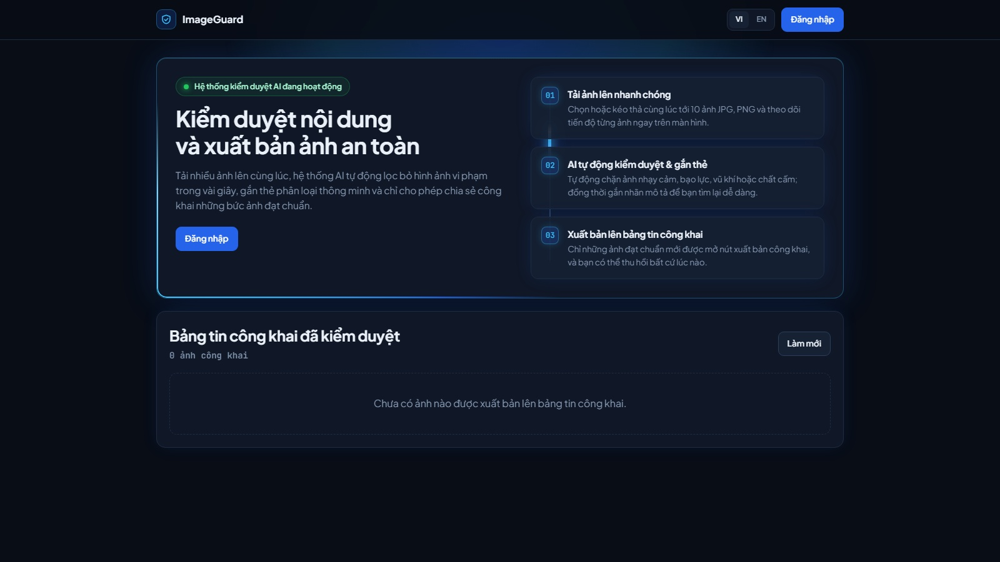
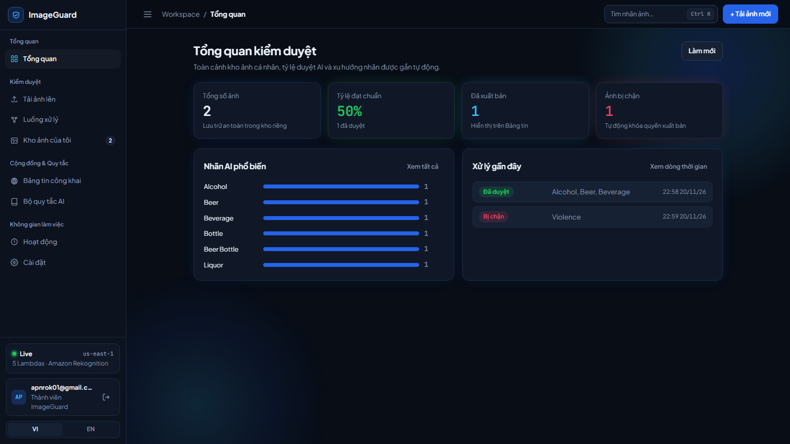
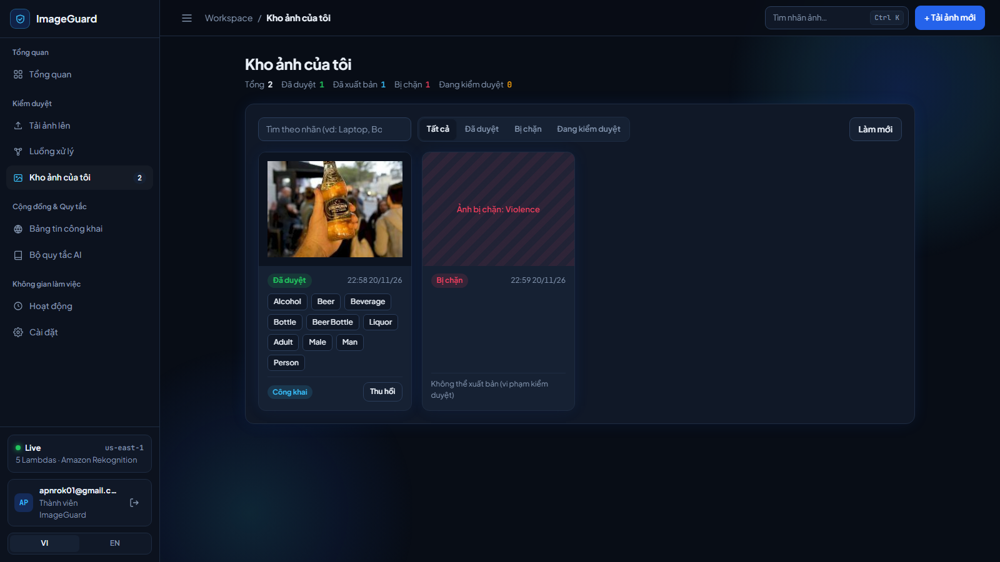

**Trải nghiệm trực tiếp:** [https://d1726d6l9yiqcj.cloudfront.net/](https://d1726d6l9yiqcj.cloudfront.net/)

**Video demo:** `[Dán link YouTube / Google Drive sau khi tải lên]` *(Bản video HD hoàn chỉnh đã được kết xuất sẵn tại `D:\ImageGuard_Review_EN.mp4`)*

---

## Các giao diện chính trong ứng dụng ImageGuard

### 1. Trang chủ kiểm duyệt (Guest Landing Page)
Giao diện trực quan tích hợp hiệu ứng đèn viền LED, giới thiệu quy trình 3 bước tự động và bảng tin công khai.

*Hình: Trang chủ ImageGuard phục vụ qua CloudFront với tiêu đề và nút Đăng nhập tích hợp Cognito*

### 2. Bảng điều khiển Tổng quan (Overview Dashboard)
Theo dõi các chỉ số quan trọng (KPIs): tổng số ảnh, tỷ lệ duyệt đạt chuẩn 50%, số ảnh đã xuất bản, biểu đồ tần suất nhãn Rekognition và nhật ký hoạt động.

*Hình: Màn hình Tổng quan kiểm duyệt (Overview Dashboard)*

### 3. Kho ảnh cá nhân (Image Vault)
Quản lý các ảnh đã tải lên, hiển thị chi tiết nhãn nhận diện, danh mục vi phạm bị chặn và nút xuất bản/thu hồi khỏi bảng tin công khai.

*Hình: Kho ảnh cá nhân với phân loại APPROVED (ảnh bia) và REJECTED (súng đồ chơi)*

### 4. Tương thích thiết bị di động (Mobile Responsive)
Bố cục co giãn linh hoạt, menu drawer trượt mượt mà, tối ưu hóa kích thước nút bấm và thẻ ảnh cho thao tác cảm ứng một tay.

*Hình: Giao diện ImageGuard hiển thị trên điện thoại thông minh*

---

## Kịch bản video (5–7 phút)

| Thời điểm | Nội dung |
|---|---|
| 0:00 | Giới thiệu bài toán và sơ đồ kiến trúc (mục 5.3) |
| 1:00 | Mở web qua CloudFront → Đăng nhập / đăng ký bằng Cognito |
| 2:00 | Upload ảnh bia → vài giây sau chuyển **APPROVED**, hiện nhãn |
| 2:45 | Upload ảnh súng đồ chơi → **REJECTED**, mở email cảnh báo (nhắc ví dụ false positive) |
| 3:30 | DynamoDB: item có `userId` = `sub`, `moderationLabels`, `labels` |
| 4:00 | CloudWatch dashboard: số ảnh APPROVED/REJECTED, thời gian xử lý, alarm |
| 4:45 | Bảo mật: gọi API không token → 401; mở thẳng S3 → AccessDenied |
| 5:30 | Chi phí: AWS Pricing Calculator 8,37 USD/tháng |
| 6:00 | Tổng kết, hướng mở rộng (admin duyệt lại ảnh REJECTED, AWS WAF, presigned POST giới hạn dung lượng) |
